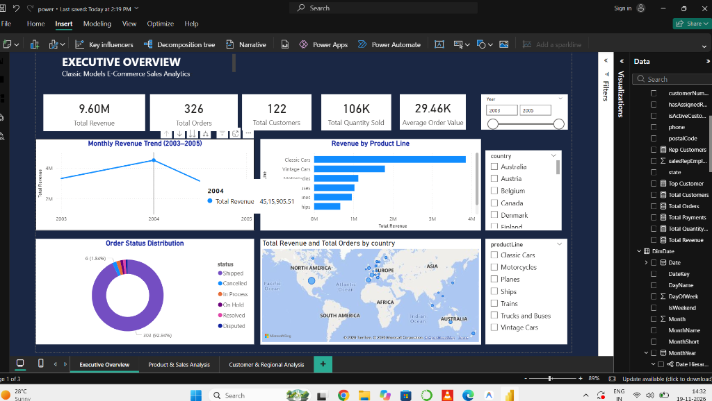
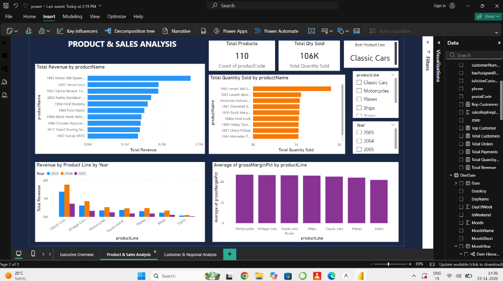
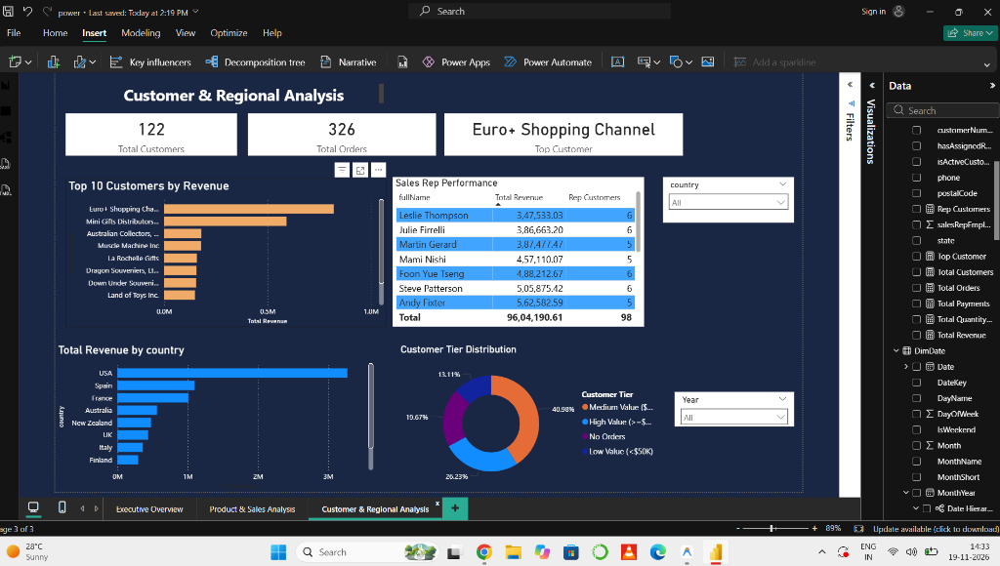

<div align="center">

# Classic Models: Sales & Customer Analytics

**An end-to-end analytics project using SQL, Python, and Power BI**

[-blue.svg)](#about-the-project)
[](#power-bi-dashboards)
[](#python-analysis)
[](#sql-analysis)

</div>

---

## Table of Contents

1. [About the Project](#about-the-project)
2. [Key Numbers](#key-numbers)
3. [Power BI Dashboards](#power-bi-dashboards)
4. [Data Model](#data-model)
5. [DAX Measures](#dax-measures)
6. [SQL Analysis](#sql-analysis)
7. [Python Analysis](#python-analysis)
8. [Data Cleaning](#data-cleaning)
9. [What the Data Suggests](#what-the-data-suggests)
10. [Limitations](#limitations)
11. [Repository Structure](#repository-structure)
12. [How to Run It](#how-to-run-it)
13. [Documentation](#documentation)
14. [About Me](#about-me)

---

## About the Project

Classic Models is a well-known sample database for a company that sells die-cast scale models (Classic Cars, Vintage Cars, Motorcycles, Planes, Ships, Trains, and Trucks & Buses). It is a practice dataset, not real company data, and it covers orders from **January 2003 to May 2005**.

I used it to practice the full analytics workflow, from raw tables to a finished dashboard.

**Questions I wanted to answer**
- Which product lines and products bring in the most revenue?
- Which customers and countries matter most, and how concentrated is the revenue?
- How many orders ship, and how many get cancelled or stuck?
- How do sales reps compare, and are there customers with no rep?

**What I built**
- **SQL (MySQL):** scripts to create the database, check the data, and answer business questions using joins, CTEs, and window functions.
- **Python:** scripts to clean the data and create the star-schema tables, plus a notebook for exploratory analysis.
- **Power BI:** a 3-page interactive dashboard with 10+ DAX measures, slicers, and a star-schema model.

---

## Key Numbers

All figures come from the order line data (quantity ordered × price each).

| Metric | Value | Note |
| :--- | :--- | :--- |
| **Total Revenue** | **$9,604,190.61** | Across all orders from 2003 to 2005, including cancelled ones |
| **Total Orders** | **326** | Between January 6, 2003 and May 31, 2005 |
| **Customers** | **122** | 98 of them placed at least one order |
| **Units Sold** | **105,516** | |
| **Average Order Value** | **$29,460.71** | |
| **Payments Received** | **$8,853,839.23** | About $750K less than total order value |
| **Repeat Customer Rate** | **93.88%** | 92 of the 98 customers who ordered placed more than one order |
| **Shipped Orders** | **92.94%** | 303 shipped, 6 cancelled, 6 in process, the rest on hold, resolved, or disputed |

**Orders by year** (2005 is a partial year, ending May 31):

| Year | Orders | Revenue |
| :--- | :--- | :--- |
| 2003 | 111 | ~$3.52M |
| 2004 | 151 | ~$4.72M |
| 2005 (Jan to May) | 64 | ~$1.37M |

The 326 orders contain **2,996 order lines**, about 9.2 products per order.

**Revenue by product line:** Classic Cars $3.85M (40.1%), Vintage Cars $1.80M (18.7%), Motorcycles $1.12M (11.7%), Trucks and Buses $1.02M (10.7%), Planes $0.95M (9.9%), Ships $0.66M (6.9%), Trains $0.19M (2.0%).

---

## Power BI Dashboards

The report has three pages with a dark navy theme. Slicers for year, country, and product line filter the visuals on each page.

### Page 1: Executive Overview
A one-screen summary of the business.



- **KPI cards:** revenue ($9.60M), orders (326), customers (122), units sold (106K), and average order value ($29.46K)
- **Monthly revenue trend (2003 to 2005)**
- **Revenue by product line:** Classic Cars lead with 40.1% of revenue
- **Order status:** donut chart showing 92.94% of orders shipped
- **Map:** revenue and orders by country

### Page 2: Product & Sales Analysis
Which products and product lines drive sales.



- **Total products and units sold,** with Classic Cars as the best product line
- **Top products by revenue:** led by the 1992 Ferrari 360 Spider and the 2001 Ferrari Enzo
- **Top products by quantity sold**
- **Revenue by product line for each year** (2003, 2004, 2005)
- **Average gross margin % by product line:** in the mid-40% range across all lines (based on MSRP versus buy price, not actual selling price)

### Page 3: Customer & Regional Analysis
Who the customers are, where they are, and how reps perform.



- **Top 10 customers by revenue:** Euro+ Shopping Channel is first with $820,689, followed by Mini Gifts Distributors with $591,827
- **Revenue by country:** the USA is first, followed by Spain and France
- **Sales rep performance:** revenue and number of customers per rep (Gerard Hernandez is highest at $1.26M)
- **Customer tiers:** High Value (≥ $100K), Medium Value ($50K to $100K), Low Value (< $50K), and customers with no orders

---

## Data Model

I reshaped the original tables into a star schema, with two fact tables (order lines and payments) and shared dimension tables. All relationships are one-to-many with single-direction filtering.

````
                  ┌───────────────┐
                  │    DimDate    │
                  └───────┬───────┘
                          │ 1
                          │
                          ▼ *
┌─────────────┐   * ┌──────────────────┐ *   1 ┌───────────────┐
│ DimCustomer ├────►│ FactOrderDetails │◄─────┤  DimProduct   │
└──────┬──────┘     └────────▲─────────┘      └───────────────┘
       │ 1                   │ *
       │                     │ 1
       │            ┌────────┴────────┐
       │            │   DimEmployee   │
       │            └────────┬────────┘
       │                     │ *
       │ 1                   ▼ 1
       │            ┌─────────────────┐
       │            │    DimOffice    │
       │            └─────────────────┘
       ▼ *
┌──────────────┐
│ FactPayments │
└──────────────┘
````

| Dimension | Join column | Fact / table | Cardinality |
| :--- | :--- | :--- | :--- |
| `DimCustomer` | `customerNumber` | `FactOrderDetails` | One to many |
| `DimProduct` | `productCode` | `FactOrderDetails` | One to many |
| `DimEmployee` | `employeeNumber` to `salesRepEmployeeNumber` | `FactOrderDetails` | One to many |
| `DimDate` | `DateKey` | `FactOrderDetails` | One to many |
| `DimCustomer` | `customerNumber` | `FactPayments` | One to many |
| `DimDate` | `DateKey` | `FactPayments` | One to many |
| `DimOffice` | `officeCode` | `DimEmployee` | One to many |

---

## DAX Measures

The main measures behind the dashboard:

````dax
// Revenue = quantity x price for every order line (includes all order statuses)
Total Revenue = SUM(FactOrderDetails[lineRevenue])

Total Orders = DISTINCTCOUNT(FactOrderDetails[orderNumber])

// All 122 customers, including those who never ordered
Total Customers = DISTINCTCOUNT(DimCustomer[customerNumber])

Total Quantity Sold = SUM(FactOrderDetails[quantityOrdered])

Average Order Value = DIVIDE([Total Revenue], [Total Orders], 0)

Total Payments = SUM(FactPayments[amount])

// Customer with the highest revenue in the current filter
Top Customer =
CALCULATE(
    SELECTEDVALUE(DimCustomer[customerName]),
    TOPN(1, ALL(DimCustomer), [Total Revenue], DESC)
)

// Customers who placed more than one order
Repeat Customers =
CALCULATE(
    DISTINCTCOUNT(FactOrderDetails[customerNumber]),
    FILTER(
        VALUES(FactOrderDetails[customerNumber]),
        CALCULATE(DISTINCTCOUNT(FactOrderDetails[orderNumber])) > 1
    )
)

// Divided by customers who ordered (98), not all customers (122)
Repeat Customer Rate % =
DIVIDE(
    [Repeat Customers],
    DISTINCTCOUNT(FactOrderDetails[customerNumber]),
    0
) * 100
````

More measures (month-over-month growth, YTD revenue, order status counts, low-stock products) are in [powerbi/README_POWERBI.md](powerbi/README_POWERBI.md).

---

## SQL Analysis

The `sql/` folder has scripts for building the database, checking the data, and analysing sales, customers, products, and employees. Two examples from [09_advanced_analysis.sql](sql/09_advanced_analysis.sql):

````sql
-- 1. Month-over-Month Revenue Growth with LAG()
WITH MonthlySales AS (
  SELECT 
    DATE_FORMAT(o.orderDate, '%Y-%m') AS YearMonth,
    SUM(od.quantityOrdered * od.priceEach) AS CurrentMonthRev
  FROM orders o
  JOIN orderdetails od ON o.orderNumber = od.orderNumber
  WHERE o.status = 'Shipped'
  GROUP BY DATE_FORMAT(o.orderDate, '%Y-%m')
)
SELECT 
  YearMonth,
  CurrentMonthRev,
  LAG(CurrentMonthRev, 1) OVER (ORDER BY YearMonth) AS PriorMonthRev,
  ROUND(((CurrentMonthRev - LAG(CurrentMonthRev, 1) OVER (ORDER BY YearMonth)) 
    / LAG(CurrentMonthRev, 1) OVER (ORDER BY YearMonth)) * 100, 2) AS MoM_Growth_Pct
FROM MonthlySales;

-- 2. Customer Spending Tier Classification with Window Ranking
SELECT 
  c.customerName,
  c.country,
  SUM(od.quantityOrdered * od.priceEach) AS TotalSpend,
  DENSE_RANK() OVER (ORDER BY SUM(od.quantityOrdered * od.priceEach) DESC) AS SpendRank,
  CASE 
    WHEN SUM(od.quantityOrdered * od.priceEach) >= 100000 THEN 'Tier 1 - High Value (>=$100K)'
    WHEN SUM(od.quantityOrdered * od.priceEach) >= 50000  THEN 'Tier 2 - Mid Value ($50K-$100K)'
    ELSE 'Tier 3 - Low Value (<$50K)'
  END AS CustomerTier
FROM customers c
JOIN orders o ON c.customerNumber = o.customerNumber
JOIN orderdetails od ON o.orderNumber = od.orderNumber
GROUP BY c.customerNumber, c.customerName, c.country;
````

---

## Python Analysis

The notebook [ecommerce_sales_analysis.ipynb](python/ecommerce_sales_analysis.ipynb) covers:

1. Loading the raw tables and checking their keys
2. Profiling missing values
3. Checking distributions of prices and order quantities
4. Looking at correlations between price and quantity
5. Segmenting customers by how often and how much they order

---

## Data Cleaning

[data_cleaning.py](python/data_cleaning.py) handles the issues I found in the raw data:

| Table | Issue | What I did |
| :--- | :--- | :--- |
| `customers` | Unnamed header column, missing states and address line 2 | Renamed the key to `customerNumber` and filled missing states with `'N/A'` |
| `customers` | 24 customers with no sales rep | Added a `hasAssignedRep` flag and used placeholder rep ID `0` so relationships still work |
| `employees` | The President has no manager (`NULL` in `reportsTo`) | Used placeholder manager ID `0` |
| `orders` | No shipping date on cancelled and in-process orders | Kept the dates empty and added an `isShipped` flag |
| `productlines` | `htmlDescription` and `image` columns were empty | Dropped them |
| `products` | Some products with low stock (< 100 units) | Added an `isLowStock` flag and calculated margins |

---

## What the Data Suggests

These are observations from this dataset and ideas worth investigating, not proven conclusions.

1. **Revenue depends on a few customers.** Euro+ Shopping Channel and Mini Gifts Distributors together bring in about $1.41M, roughly 14.7% of revenue. Losing either would hurt, so dedicated account management could be worth it.
2. **Classic Cars carry the business.** They make up 40.1% of revenue, while Trains make up only 2.0% ($189K). It may be worth checking whether Trains justify their inventory and production costs.
3. **Revenue tends to peak in the last quarter of the year.** If that holds up, ordering stock earlier could help avoid shortages. With only about 2.5 years of data (and 2005 stopping in May), I would want more history before relying on it.
4. **24 customers have no assigned sales rep.** Giving them to reps with fewer accounts could be a way to find new sales.

---

## Limitations

- This is a sample dataset with only 326 orders over about 2.5 years (January 2003 to May 2005), so patterns may not hold in real business data.
- 2005 only runs through May, so comparing 2005 with earlier full years is not like-for-like.
- Revenue includes every order status, including cancelled and disputed orders.
- Gross margin is based on MSRP versus buy price, not on actual selling prices.
- The dashboard reads from CSV files, so it does not update automatically.

---

## Repository Structure

````text
classic-models-data-analytics/
├── assets/                       # Dashboard screenshots
│   ├── dashboard_page1.png
│   ├── dashboard_page2.png
│   └── dashboard_page3.png
├── data/
│   ├── raw/                      # Original CSV files
│   ├── cleaned/                  # Cleaned CSV files
│   └── powerbi_ready/            # Star-schema tables for Power BI
│       ├── DimCustomer.csv
│       ├── DimDate.csv
│       ├── DimEmployee.csv
│       ├── DimOffice.csv
│       ├── DimProduct.csv
│       ├── FactOrderDetails.csv
│       └── FactPayments.csv
├── sql/                          # MySQL scripts
│   ├── 01_create_database.sql
│   ├── 02_create_tables.sql
│   ├── 03_data_validation.sql
│   ├── 04_basic_analysis.sql
│   ├── 05_sales_analysis.sql
│   ├── 06_customer_analysis.sql
│   ├── 07_product_analysis.sql
│   ├── 08_employee_analysis.sql
│   └── 09_advanced_analysis.sql
├── python/                       # Cleaning scripts and analysis notebook
│   ├── data_cleaning.py
│   ├── powerbi_data_prep.py
│   └── ecommerce_sales_analysis.ipynb
├── powerbi/
│   ├── ClassicModels_Dashboard.pbix   # Power BI report
│   └── README_POWERBI.md              # DAX measures and dashboard build guide
├── documentation/                # Data dictionary, model notes, project write-up
│   ├── data_dictionary.md
│   ├── data_quality_report.md
│   ├── data_model.md
│   ├── business_insights.md
│   ├── interview_questions.md
│   └── project_explanation.md
└── README.md
````

---

## How to Run It

### 1. Database (MySQL)
````bash
git clone https://github.com/premramole/Classic-models-data-analytics.git
cd Classic-models-data-analytics/sql

# Run the scripts in order in MySQL Workbench or the command line
mysql -u root -p < 01_create_database.sql
mysql -u root -p < 02_create_tables.sql
````

### 2. Python
````bash
python -m venv venv
source venv/bin/activate   # On Windows: venv\Scripts\activate
pip install pandas numpy matplotlib seaborn jupyter

python python/data_cleaning.py
python python/powerbi_data_prep.py
````

### 3. Power BI
1. Open Power BI Desktop.
2. Choose **Get Data**, then **Text/CSV**, and load every file in `data/powerbi_ready/`.
3. Open Model View and check that the relationships match the data model above.
4. Use [powerbi/README_POWERBI.md](powerbi/README_POWERBI.md) for the DAX measures and visual settings.

---

## Documentation

The [documentation](documentation/) folder has more detail:
- [project_explanation.md](documentation/project_explanation.md): a walkthrough of the project at different lengths
- [data_dictionary.md](documentation/data_dictionary.md), [data_model.md](documentation/data_model.md), and [data_quality_report.md](documentation/data_quality_report.md): the data and how I checked it
- [business_insights.md](documentation/business_insights.md): a longer write-up of the findings

---

## About Me

**Prem Ramole**, Computer Engineering graduate (2026), looking for Data Analyst and BI Developer roles.

- LinkedIn: [linkedin.com/in/prem-ramole-779088298](https://linkedin.com/in/prem-ramole-779088298)
- GitHub: [github.com/premramole](https://github.com/premramole)
- Email: prem.ramole3@gmail.com
````
`
