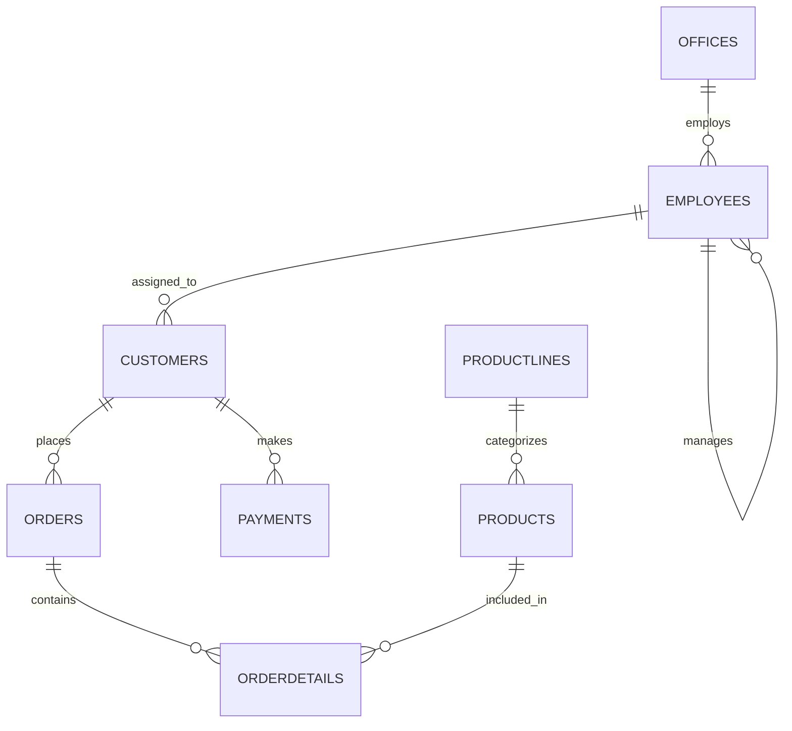

# Data Model Documentation

## Entity-Relationship Diagram (Text)

## Primary and Foreign Keys
- **offices**: PK = `officeCode`
- **employees**: PK = `employeeNumber`, FK1 = `officeCode` (offices), FK2 = `reportsTo` (employees)
- **customers**: PK = `customerNumber`, FK = `salesRepEmployeeNumber` (employees)
- **payments**: PK = `checkNumber`, FK = `customerNumber` (customers)
- **orders**: PK = `orderNumber`, FK = `customerNumber` (customers)
- **orderdetails**: PK = (`orderNumber`, `productCode`), FK1 = `orderNumber` (orders), FK2 = `productCode` (products)
- **products**: PK = `productCode`, FK = `productLine` (productlines)
- **productlines**: PK = `productLine`

## Cardinalities
- 1 Office to Many Employees (1:*)
- 1 Employee to Many Customers (1:*)
- 1 Customer to Many Orders (1:*)
- 1 Customer to Many Payments (1:*)
- 1 Order to Many OrderDetails (1:*)
- 1 Product to Many OrderDetails (1:*)
- 1 Product Line to Many Products (1:*)

## Join Paths for Key Questions
- **Revenue by Sales Rep**: `employees` -> `customers` -> `orders` -> `orderdetails`
- **Product Popularity by Region**: `productlines` -> `products` -> `orderdetails` -> `orders` -> `customers`
- **Payment Timeliness**: `payments` (via `customerNumber`) compared to `orders`

## Star Schema Design Approach
For BI purposes, this transactional normalized schema is transformed into a Star Schema. 
- **Facts**: `orderdetails` (sales amounts), `payments` (cash inflows).
- **Dimensions**: `employees` (flattened with `offices`), `customers`, `products` (flattened with `productlines`), and a `Date` dimension.
This reduces complex multi-table joins in DAX/SQL to simpler filtering scenarios, boosting dashboard query performance.
